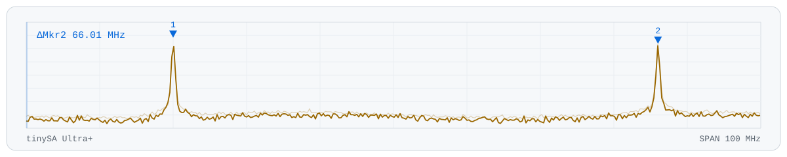

<picture>
  <source media="(prefers-color-scheme: dark)" srcset="assets/banner-dark.svg">
  
</picture>

# Linux Wi-Fi driver developer and firmware reverse engineer

    

Full-time on Linux internals, reverse engineering and vulnerability research since January 2026. Everything below is from this year.

<table>
<tr>
<td width="50%" valign="top">
 <b><a href="https://git.kernel.org/pub/scm/linux/kernel/git/torvalds/linux.git/commit/?id=7825de3f75d1">Applied by Linus Torvalds</a></b> 
A fix for an mt792x crash that left laptops without Wi-Fi, pulled straight off the mailing list into mainline.
</td>
<td width="50%" valign="top">
 <b><a href="https://sec.cloudapps.cisco.com/security/center/content/CiscoSecurityAdvisory/cisco-sa-te-agentfilewrite-tqUw3SMU">CVE-2026-20161, credited by Cisco</a></b> 
The ThousandEyes Enterprise Agent let a low-privileged local user overwrite any file on the machine.
</td>
</tr>
<tr>
<td width="50%" valign="top">
 <b><a href="https://patchwork.kernel.org/project/linux-wireless/list/?submitter=219860&state=%2A&archive=both">32 patches in mainline Linux</a></b> 
Fixes in the mt76 (MediaTek), rtw89 (Realtek) and mac80211 Wi-Fi code. Thirteen landed in the 7.4 merge window, and three more are queued.
</td>
<td width="50%" valign="top">
 <b><a href="#-linux-kernel-wi-fi-drivers-mt76-rtw89-mac80211">Working with MediaTek and Realtek</a></b> 
Patches co-developed with MediaTek engineers, and rtw89 fixes acked by Realtek's maintainer.
</td>
</tr>
<tr>
<td width="50%" valign="top">
 <b><a href="#aic8800-open-firmware-clean-room-in-progress">Open firmware for the AIC8800</a></b> 
Clean-room firmware for the AICSemi AIC8800 USB Wi-Fi chip. It now receives and transmits 802.11 frames with none of the vendor's firmware loaded.
</td>
<td width="50%" valign="top">
 <b><a href="mailto:lucid_duck@justthetip.ca?subject=Contract%20inquiry">Available for remote contracts</a></b> 
Linux Wi-Fi and USB driver development, firmware and protocol reverse engineering, vulnerability research.
</td>
</tr>
</table>

📍 Vancouver Island, BC, Canada &nbsp;·&nbsp; ✉️ lucid_duck@justthetip.ca &nbsp;·&nbsp; 🌐 [justthetip.ca](https://justthetip.ca) &nbsp;·&nbsp; ☕ [Ko-fi](https://ko-fi.com/lucid_duck)

---

## 🐧 Linux kernel Wi-Fi drivers: mt76, rtw89, mac80211

Of the thirty-two in mainline, twelve carry a stable tag. Eleven have shipped in the stable trees, across eight branches back to 5.10. The oldest bug fixed dates to 2017.

The kernel has assigned CVEs to seven of these fixes: CVE-2026-68193, CVE-2026-68194, CVE-2026-68195, CVE-2026-80825, CVE-2026-80936, CVE-2026-90382 and CVE-2026-98182. Each is linked under its commit in the table below.

Most of them share a cause. USB and SDIO adapters, and monitor mode, run through code written and tested mainly for PCIe cards doing ordinary client traffic.

Fourteen more mainline commits credit me for reporting, testing or carrying them upstream.

Outside wireless, two fixes to the DRM panic screen are queued for mainline. A log line too long for its buffer left the screen looping forever, so the panic never finished, and setting the screen mode with echo failed on the trailing newline.

<b>Every mainline patch, and what was wrong</b>

| Patch | Commit | Role | What was wrong |
|---|---|---|---|
| [mt76 / mt792x: fix NULL dereference in ACPI SAR init during probe](https://patch.msgid.link/20260825181712.28548-1-lucid_duck@justthetip.ca) | [`7825de3f75d1`](https://git.kernel.org/pub/scm/linux/kernel/git/torvalds/linux.git/commit/?id=7825de3f75d1) | Authored | On laptops carrying a vendor power table in firmware, the driver crashed during startup and the Wi-Fi never came up |
| [mt76 / mt792x: pick the SAR table layout from the table itself](https://patch.msgid.link/20260905013551.24635-1-lucid_duck@justthetip.ca) | [`af97bf5a7e72`](https://git.kernel.org/pub/scm/linux/kernel/git/torvalds/linux.git/commit/?id=af97bf5a7e72) | Authored | When a laptop's firmware labelled its power tables with the wrong version, the driver read every entry a byte out of place and dropped the 6 GHz limits |
| [mac80211: refuse to make a monitor active when it has no queue](https://patch.msgid.link/20260904200338.10829-1-lucid_duck@justthetip.ca) | [`2b04d6556964`](https://git.kernel.org/pub/scm/linux/kernel/git/torvalds/linux.git/commit/?id=2b04d6556964) [CVE-2026-98182](https://www.cve.org/CVERecord?id=CVE-2026-98182) | Authored | Flagging a monitor interface active while it was down left it with no transmit queue, and ath9k crashed on it |
| [rtw89: fix USB TX flow control by tracking in-flight URBs](https://patch.msgid.link/20260402052216.207858-1-lucid_duck@justthetip.ca) | [`80119a77e5b0`](https://git.kernel.org/pub/scm/linux/kernel/git/torvalds/linux.git/commit/?id=80119a77e5b0) | Authored | Asked how much transmit room was left, the driver answered a hardcoded 42, so nothing ever throttled |
| [mt76 / mt7925: ensure tx headroom in usb_sdio_tx_prepare_skb](https://patch.msgid.link/20260715023348.59506-1-lucid_duck@justthetip.ca) | [`ef3e34874d23`](https://git.kernel.org/pub/scm/linux/kernel/git/torvalds/linux.git/commit/?id=ef3e34874d23) [CVE-2026-80825](https://www.cve.org/CVERecord?id=CVE-2026-80825) | Authored | Bridging wired traffic into a Wi-Fi access point panicked the kernel |
| [mt76 / mt7921, mt7925, mt7615: drop TXRX_NOTIFY on non-MMIO buses](https://patch.msgid.link/20260627191336.20223-2-lucid_duck@justthetip.ca) | [`da4082e91aca`](https://git.kernel.org/pub/scm/linux/kernel/git/torvalds/linux.git/commit/?id=da4082e91aca), [`feeff151c83e`](https://git.kernel.org/pub/scm/linux/kernel/git/torvalds/linux.git/commit/?id=feeff151c83e), [`39afc46c0243`](https://git.kernel.org/pub/scm/linux/kernel/git/torvalds/linux.git/commit/?id=39afc46c0243) [CVE-2026-68194](https://www.cve.org/CVERecord?id=CVE-2026-68194), [CVE-2026-68193](https://www.cve.org/CVERecord?id=CVE-2026-68193), [CVE-2026-68195](https://www.cve.org/CVERecord?id=CVE-2026-68195) | Authored | An event that only exists on PCIe and built-in SoC radios crashed USB and SDIO adapters |
| [mt76: restrict NPU/PPE active checks to MMIO devices](https://patch.msgid.link/20260720232640.41293-1-lucid_duck@justthetip.ca) | [`7981aca2bd28`](https://git.kernel.org/pub/scm/linux/kernel/git/torvalds/linux.git/commit/?id=7981aca2bd28) | Authored | USB adapters read a field that means nothing off PCIe, skipped frame reordering, and lost throughput as access points |
| [mt76 / mt7925: cancel mlo_pm_work on stop](https://patch.msgid.link/20260627202946.25598-1-lucid_duck@justthetip.ca) | [`81faf578320d`](https://git.kernel.org/pub/scm/linux/kernel/git/torvalds/linux.git/commit/?id=81faf578320d) [CVE-2026-80936](https://www.cve.org/CVERecord?id=CVE-2026-80936) | Authored | A power-save timer kept firing after the device it belonged to was gone |
| [mt76 / mt7925: don't put the band auto marker in TGID](https://patch.msgid.link/20260911024428.65244-1-lucid_duck@justthetip.ca) | [`5796b2bf9ff7`](https://git.kernel.org/pub/scm/linux/kernel/git/torvalds/linux.git/commit/?id=5796b2bf9ff7) | Authored | Every data frame from an access point or a multi-link station went out tagged with a bogus band number |
| [mt76 / mt76x02: report rx FCS errors to mac80211](https://patch.msgid.link/20260613002544.27750-3-lucid_duck@justthetip.ca) | [`ddae0bcb01e7`](https://git.kernel.org/pub/scm/linux/kernel/git/torvalds/linux.git/commit/?id=ddae0bcb01e7) | Authored | Captures could not tell a corrupted frame from a clean one |
| [mt76 / mt76x02: do not WARN on invalid rx descriptor length](https://patch.msgid.link/20260613002544.27750-2-lucid_duck@justthetip.ca) | [`81497634d9f8`](https://git.kernel.org/pub/scm/linux/kernel/git/torvalds/linux.git/commit/?id=81497634d9f8) [CVE-2026-90382](https://www.cve.org/CVERecord?id=CVE-2026-90382) | Authored | Any garbage frame off the air tainted the kernel, and crashed machines set to panic on warnings |
| [mt76 / mt792x: do not advertise active monitor](https://patch.msgid.link/20260722011302.113060-1-lucid_duck@justthetip.ca) | [`6f6c9800e54c`](https://git.kernel.org/pub/scm/linux/kernel/git/torvalds/linux.git/commit/?id=6f6c9800e54c) | Authored | Turned off a capture mode that received nothing. I later traced the real cause to the wireless stack and posted [a series that makes it work](https://lore.kernel.org/linux-wireless/20261027195803.711995-1-lucid_duck@justthetip.ca/) |
| [mt76 / mt7921: assert sniffer on chanctx change](https://patch.msgid.link/20260515183921.23484-1-lucid_duck@justthetip.ca) | [`a7d35545c2ce`](https://git.kernel.org/pub/scm/linux/kernel/git/torvalds/linux.git/commit/?id=a7d35545c2ce) | Authored | The mt7921 driver never re-set sniffer mode after a channel change, the gap behind a capture regression in 6.17 and 6.18 |
| [mt76: move the channel survey when the channel changes](https://patch.msgid.link/20261001003501.2425492-1-lucid_duck@justthetip.ca) | [`68342a7bd7e5`](https://git.kernel.org/pub/scm/linux/kernel/git/torvalds/linux.git/commit/?id=68342a7bd7e5) | Authored | mt7921 and mt7925 booked every channel survey counter to the first channel of the band, whichever channel the radio was really on |
| [rtw89: usb: shorten the RX aggregation hold on RTL8922AU over USB 3](https://patch.msgid.link/20261007210958.56528-1-lucid_duck@justthetip.ca) | [`83de3a16c7b3`](https://git.kernel.org/pub/scm/linux/kernel/git/torvalds/linux.git/commit/?id=83de3a16c7b3) | Authored | The adapter held received frames for up to a millisecond before passing them on, so downloads over USB 3 at 160 MHz ran about 40 percent slower than the link allowed |
| [mt76 / mt792x: defer the MCU shutdown past unregister on USB](https://patch.msgid.link/20260923172424.24021-1-lucid_duck@justthetip.ca) | [`3c334603f0ec`](https://git.kernel.org/pub/scm/linux/kernel/git/torvalds/linux.git/commit/?id=3c334603f0ec) | Authored | Unloading a USB adapter shut its firmware down too early, so every remaining command timed out and queued a chip reset on a device being removed |
| [mt76 / mt7925: cancel mlo_pm_work on the USB stop path](https://patch.msgid.link/20261003234944.96066-1-lucid_duck@justthetip.ca) | [`9f299215d1d8`](https://git.kernel.org/pub/scm/linux/kernel/git/torvalds/linux.git/commit/?id=9f299215d1d8) | Authored | My earlier fix for this timer, 81faf578320d, covered PCIe but missed USB, where it still ran after the interface went down |
| [mt76: take rcu_read_lock in the USB/SDIO tx completion path](https://patch.msgid.link/20261003233056.94497-1-lucid_duck@justthetip.ca) | [`a7871a7ae5a8`](https://git.kernel.org/pub/scm/linux/kernel/git/torvalds/linux.git/commit/?id=a7871a7ae5a8) | Authored | USB and SDIO adapters looked up the sending station on every transmit completion without the lock that keeps it from being freed |
| [mt76 / mt7921: honour FIF_FCSFAIL instead of hardcoding drop_err](https://patch.msgid.link/20260826231029.39632-1-lucid_duck@justthetip.ca) | [`f8794eb3ff6d`](https://git.kernel.org/pub/scm/linux/kernel/git/torvalds/linux.git/commit/?id=f8794eb3ff6d) | Authored | A capture that asked to see frames with bad checksums never got them, because the driver told the sniffer to drop them anyway |
| [mt76 / mt7921, mt7925: fix the lock inversion in suspend and resume](https://patch.msgid.link/20260830064201.92285-2-lucid_duck@justthetip.ca) | [`0e6472108d51`](https://git.kernel.org/pub/scm/linux/kernel/git/torvalds/linux.git/commit/?id=0e6472108d51), [`a105a9fe9a07`](https://git.kernel.org/pub/scm/linux/kernel/git/torvalds/linux.git/commit/?id=a105a9fe9a07) | Authored | Suspend and resume took two locks in the opposite order to the rest of the wireless stack, a deadlock waiting on the wrong timing |
| [mt76 / mt7921, mt7925: fix lock inversion between dev->mutex and iflist_mtx](https://patch.msgid.link/20260810045338.118923-2-lucid_duck@justthetip.ca) | [`3dcb98c5cb51`](https://git.kernel.org/pub/scm/linux/kernel/git/torvalds/linux.git/commit/?id=3dcb98c5cb51), [`320862312130`](https://git.kernel.org/pub/scm/linux/kernel/git/torvalds/linux.git/commit/?id=320862312130) | Authored | Deleting a monitor interface that had a channel took the same two locks in opposite orders in the driver and the stack, and lockdep flagged the deadlock |
| [mt76 / mt7921, mt7925: check drv_pmctrl return in the PCIe reset path](https://patch.msgid.link/20260809012309.43657-1-lucid_duck@justthetip.ca) | [`75673ab3c0e4`](https://git.kernel.org/pub/scm/linux/kernel/git/torvalds/linux.git/commit/?id=75673ab3c0e4), [`d12a54be2604`](https://git.kernel.org/pub/scm/linux/kernel/git/torvalds/linux.git/commit/?id=d12a54be2604) | Authored | When a PCIe card would not hand control back to the driver, the reset carried on anyway and loaded firmware onto a chip the driver did not own |
| [mac80211: fix monitor filter refcount leak](https://patch.msgid.link/20260904202817.12564-1-lucid_duck@justthetip.ca) | [`feb3a036d1cd`](https://git.kernel.org/pub/scm/linux/kernel/git/torvalds/linux.git/commit/?id=feb3a036d1cd) | Authored | Bringing an active monitor interface up and down leaked a count, so the hardware receive filter was never reset |
| [mt76 / connac: cache txpower_cur via a helper](https://patch.msgid.link/20260401182322.64355-1-sean.wang@kernel.org) | [`8286bbf62dcc`](https://git.kernel.org/pub/scm/linux/kernel/git/torvalds/linux.git/commit/?id=8286bbf62dcc) | Co-authored | Groundwork for fixing adapters that reported transmit power for the wrong channel |
| [mt76 / connac: factor out rate power limit calculation](https://patch.msgid.link/20260401182322.64355-2-sean.wang@kernel.org) | [`317bc1a0590e`](https://git.kernel.org/pub/scm/linux/kernel/git/torvalds/linux.git/commit/?id=317bc1a0590e) | Co-authored | Same series. Pulled the regulatory, SAR and rate-limit power steps into one helper, which the fix then reused |
| [mt76 / mt792x: fix UAF in SDIO TX path when out of memory](https://patch.msgid.link/20260914021920.32246-2-eason.lai@mediatek.com) | [`f5dd4833463e`](https://git.kernel.org/pub/scm/linux/kernel/git/torvalds/linux.git/commit/?id=f5dd4833463e) | Co-authored | When memory ran out while padding a transmit frame, the frame was freed there and again by its caller |
| [mt76 / mt7925: add Netgear A8500 USB device ID](https://patch.msgid.link/20260527144735.10254-1-lucid_duck@justthetip.ca) | [`291b067a02b9`](https://git.kernel.org/pub/scm/linux/kernel/git/torvalds/linux.git/commit/?id=291b067a02b9) | Authored | An adapter its own driver already supported but did not recognise |

### ❤️ morrownr's USB-WiFi, mt76 and rtw89 repos

Write and triage collaborator on three of [morrownr](https://github.com/morrownr)'s repos. Review, tester coordination, and the link between them, linux-wireless and upstream.

- **[USB-WiFi](https://github.com/morrownr/USB-WiFi)**: adapter reviews, a list of what actually works on Linux, chipset tables and user support. I'm listed as one of its two site maintainers.
- **[mt76](https://github.com/morrownr/mt76)**: one of its three listed maintainers. Out-of-tree builds of the mt76 driver for kernels 6.12 through 7.4, so people get current fixes without waiting on a distro. The [install scripts](https://github.com/morrownr/mt76/blob/main/install-driver.sh) handle DKMS and Secure Boot.
- **[rtw89](https://github.com/morrownr/rtw89)**: the same job for the rtw89 series, writing and testing USB drivers with the aim of getting them upstream.

With morrownr I also help a USB Wi-Fi adapter maker on Linux: answers to its engineering questions for an upcoming adapter, and Linux test data on its current lineup. Eight adapters profiled, and the flagship ran 480 test iterations across three machines without a failure.

### AIC8800 open firmware (clean-room, in progress)

This USB Wi-Fi family has no mainline support. The vendor's own driver was told upstream to be redesigned from scratch first, and the licence on its firmware is still unresolved. So I'm writing a replacement: open firmware on the chip, the standard Linux stack on the host, no vendor blob.

    reverse engineered   boot and init, the USB data path, the transmit and receive
                         rings, firmware load, and the calibration that nulls carrier
                         leakage. From the disassembly, with no source and no datasheet
    on air               the new firmware, running standalone, programs the synthesiser
                         and puts a narrow CW carrier where it is commanded. Two targets
                         66 MHz apart landed 66.01 MHz apart, each within 20 kHz, and
                         every peak vanishes with the chip powered down
    receive              it arms the receiver and streams every frame it hears on
                         2412 MHz to the host over USB, checksum included: 259 frames
                         in 20 seconds, every one good, checked frame by frame against
                         a second receiver's capture
    transmit             frames the host sends over USB go out on the air: 40 of 40
                         sent in each of two runs, and every one the second receiver
                         caught was byte-exact
    next                 getting the radio to answer frames sent to it

---

## 🔬 Contract work: firmware reverse engineering

**Automotive keyless entry, 2026.** A dozen firmware images for a hardware-security vendor, delivered and in flight. Each delivery is a C reimplementation of that firmware's cryptography and key derivation, checked byte for byte against captured radio traffic or against an emulator.

    cores      STM8, ARM Cortex-M0, PIC, HCS12 and HCS12X, V850, R32C, 8051
    ciphers    KeeLoq variants, XTEA, AES-128, a DST80-family stream cipher,
               custom block and S-box designs, several PRNGs

The hard part was getting from a stripped flash dump to a function map. Stock tooling gave up on paged flash and the uncommon cores, so I wrote a function walker, disassembler and emulator for it.

**Linux wireless driver, 2026.** Driver work for a module vendor so their USB part can carry long-range video links: fixed-rate injection and narrow channels.

---

## 🛡️ Vulnerability research

Reported through Bugcrowd and HackerOne. Vendor names are withheld where an embargo or agreement applies.

- **First CVE, arbitrary file overwrite as root.** [CVE-2026-20161](https://sec.cloudapps.cisco.com/security/center/content/CiscoSecurityAdvisory/cisco-sa-te-agentfilewrite-tqUw3SMU) (Cisco ThousandEyes). A monitoring agent running as root followed a symlink out of its own log directory, so a local user with low privileges could overwrite any file on the box. Fixed in 1.234.0.

<b>Eight more findings</b>

- **Five privilege escalations in one enterprise VPN client.** A race to SYSTEM and a forced-authentication escalation on Windows. On Linux, a local socket that ran a caller's commands as root, a path traversal through that same socket, and arbitrary file write as root by symlink.

- **Windows logon passwords readable through the same product.** Any local user could rewrite the address its credential provider sends passwords to, and the key that encrypts them is hardcoded in the product, so another user's logon password could be captured and decrypted.

- **Denial of service on a Windows endpoint-protection product.** A DNS response carrying a few thousand chained compression pointers makes the network filter recurse until it runs out of stack. The process dies and network-level protection stays down. The vendor reproduced it.

- **A certificate authority private key shipped inside firmware.** A virtual gateway's published image carries one CA key, generated once and identical in every deployment, so anyone with the public image can issue certificates every appliance trusts. Reproduced by the triager, then closed by the vendor as not applicable.

- **Licence forgery on a network management appliance.** Licences were signed with a 512-bit RSA key. Factoring the modulus recovered the private key, and licences signed with it were accepted by a live appliance.

- **SSRF to cloud credentials.** DNS rebinding got requests past a cloud networking product's SSRF filter to the instance metadata service, which hands out the host's cloud credentials.

- **Quarantine bypass and audit log forgery on a Linux endpoint product.** A world-writable scanning socket spoke an undocumented binary protocol. Once reverse engineered, it allowed a quarantine bypass and fabricated entries in the cloud console's audit log.

- **Two account takeovers at a telecom carrier.** A zero-click webmail takeover through a gap in the HTML sanitiser, and a password reset for any customer through a one-time code with no rate limit.

Further findings across identity, fintech and IoT.

---

[justthetip.ca](https://justthetip.ca): the writing, and every machine and radio on the lab bench.
