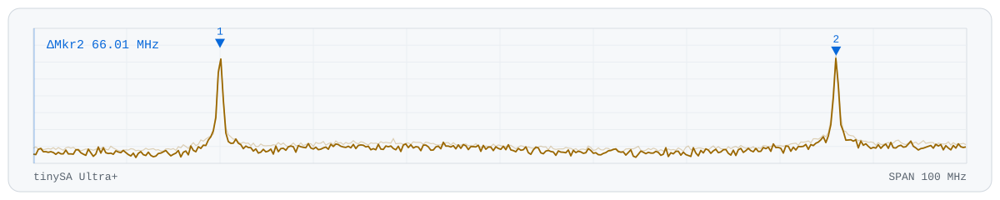

<picture>
  <source media="(prefers-color-scheme: dark)" srcset="assets/banner-dark.svg">
  
</picture>

# Linux Wi-Fi driver developer and firmware reverse engineer

    

Full-time on Linux internals, reverse engineering and vulnerability research since January 2026. Eighteen of my patches are in the mainline kernel, two of them co-developed with a MediaTek engineer, and fourteen more are accepted and on their way. Also since January: a published CVE, two paid contracts, and an open Wi-Fi firmware I'm writing from the disassembly.

<table>
<tr>
<td width="50%" valign="top">
 <b><a href="https://git.kernel.org/pub/scm/linux/kernel/git/torvalds/linux.git/commit/?id=7825de3f75d1">Applied by Linus Torvalds</a></b> 
My fix for an mt792x crash that left laptops without Wi-Fi, pulled straight off the mailing list into mainline.
</td>
<td width="50%" valign="top">
 <b><a href="https://sec.cloudapps.cisco.com/security/center/content/CiscoSecurityAdvisory/cisco-sa-te-agentfilewrite-tqUw3SMU">CVE-2026-20161, credited by Cisco</a></b> 
The ThousandEyes Enterprise Agent let a low-privileged local user overwrite any file on the machine.
</td>
</tr>
<tr>
<td width="50%" valign="top">
 <b><a href="https://patchwork.kernel.org/project/linux-wireless/list/?submitter=219860&state=%2A&archive=both">18 patches in mainline Linux</a></b> 
Fixes in the mt76 (MediaTek), rtw89 (Realtek) and mac80211 Wi-Fi code, with 14 more queued for the 7.4 merge window.
</td>
<td width="50%" valign="top">
 <b><a href="#-linux-kernel-wi-fi-drivers-mt76-rtw89-mac80211">7 Linux kernel CVEs</a></b> 
Assigned to fixes I wrote: CVE-2026-68193, CVE-2026-68194, CVE-2026-68195, CVE-2026-80825, CVE-2026-80936, CVE-2026-90382 and CVE-2026-98182.
</td>
</tr>
<tr>
<td width="50%" valign="top">
 <b><a href="#aic8800-open-firmware-clean-room-in-progress">Open firmware for the AIC8800</a></b> 
Clean-room firmware for the AICSemi AIC8800 USB Wi-Fi chip. Two carriers commanded 66 MHz apart landed 66.01 MHz apart, each within 20 kHz.
</td>
<td width="50%" valign="top">
 <b><a href="mailto:lucid_duck@justthetip.ca?subject=Contract%20inquiry">Available for remote contracts</a></b> 
Linux Wi-Fi and USB driver development, firmware and protocol reverse engineering, vulnerability research.
</td>
</tr>
</table>

📍 Vancouver Island, BC, Canada &nbsp;·&nbsp; ✉️ lucid_duck@justthetip.ca &nbsp;·&nbsp; 🌐 [justthetip.ca](https://justthetip.ca) &nbsp;·&nbsp; ☕ [Ko-fi](https://ko-fi.com/lucid_duck)

---

## 🐧 Linux kernel Wi-Fi drivers: mt76, rtw89, mac80211

Of the eighteen in mainline, seven carry a stable tag. Nine have shipped in the stable trees, across eight branches back to 5.10. The oldest bug fixed dates to 2017.

Most of them share a cause. USB and SDIO adapters, and monitor mode, run through code written and tested mainly for PCIe cards doing ordinary client traffic.

Six more mainline commits credit me for reporting, testing or carrying them upstream.

<b>Every mainline patch, and what was wrong</b>

| Patch | Commit | Role | What was wrong |
|---|---|---|---|
| [mt76 / mt792x: fix NULL dereference in ACPI SAR init during probe](https://patch.msgid.link/20260825181712.28548-1-lucid_duck@justthetip.ca) | [`7825de3f75d1`](https://git.kernel.org/pub/scm/linux/kernel/git/torvalds/linux.git/commit/?id=7825de3f75d1) | Authored | On laptops carrying a vendor power table in firmware, the driver crashed during startup and the Wi-Fi never came up. Linus applied this one straight off the mailing list |
| [mt76 / mt792x: pick the SAR table layout from the table itself](https://patch.msgid.link/20260905013551.24635-1-lucid_duck@justthetip.ca) | [`af97bf5a7e72`](https://git.kernel.org/pub/scm/linux/kernel/git/torvalds/linux.git/commit/?id=af97bf5a7e72) | Authored | When a laptop's firmware labelled its power tables with the wrong version, the driver read every entry a byte out of place and dropped the 6 GHz limits |
| [mac80211: refuse to make a monitor active when it has no queue](https://patch.msgid.link/20260904200338.10829-1-lucid_duck@justthetip.ca) | [`2b04d6556964`](https://git.kernel.org/pub/scm/linux/kernel/git/torvalds/linux.git/commit/?id=2b04d6556964) [CVE-2026-98182](https://www.cve.org/CVERecord?id=CVE-2026-98182) | Authored | Flagging a monitor interface active while it was down left it with no transmit queue, and ath9k crashed on it |
| [rtw89: fix USB TX flow control by tracking in-flight URBs](https://patch.msgid.link/20260402052216.207858-1-lucid_duck@justthetip.ca) | [`80119a77e5b0`](https://git.kernel.org/pub/scm/linux/kernel/git/torvalds/linux.git/commit/?id=80119a77e5b0) | Authored | Asked how much transmit room was left, the driver answered a hardcoded 42, so nothing ever throttled |
| [mt76 / mt7925: ensure tx headroom in usb_sdio_tx_prepare_skb](https://patch.msgid.link/20260715023348.59506-1-lucid_duck@justthetip.ca) | [`ef3e34874d23`](https://git.kernel.org/pub/scm/linux/kernel/git/torvalds/linux.git/commit/?id=ef3e34874d23) [CVE-2026-80825](https://www.cve.org/CVERecord?id=CVE-2026-80825) | Authored | Bridging wired traffic into a Wi-Fi access point panicked the kernel |
| [mt76 / mt7921, mt7925, mt7615: drop TXRX_NOTIFY on non-MMIO buses](https://patch.msgid.link/20260627191336.20223-2-lucid_duck@justthetip.ca) | [`da4082e91aca`](https://git.kernel.org/pub/scm/linux/kernel/git/torvalds/linux.git/commit/?id=da4082e91aca), [`feeff151c83e`](https://git.kernel.org/pub/scm/linux/kernel/git/torvalds/linux.git/commit/?id=feeff151c83e), [`39afc46c0243`](https://git.kernel.org/pub/scm/linux/kernel/git/torvalds/linux.git/commit/?id=39afc46c0243) [CVE-2026-68194](https://www.cve.org/CVERecord?id=CVE-2026-68194), [CVE-2026-68193](https://www.cve.org/CVERecord?id=CVE-2026-68193), [CVE-2026-68195](https://www.cve.org/CVERecord?id=CVE-2026-68195) | Authored | An event that only exists on PCIe and built-in SoC radios crashed USB and SDIO adapters |
| [mt76: restrict NPU/PPE active checks to MMIO devices](https://patch.msgid.link/20260720232640.41293-1-lucid_duck@justthetip.ca) | [`7981aca2bd28`](https://git.kernel.org/pub/scm/linux/kernel/git/torvalds/linux.git/commit/?id=7981aca2bd28) | Authored | USB adapters read a field that means nothing off PCIe, skipped frame reordering, and lost throughput as access points |
| [mt76 / mt7925: cancel mlo_pm_work on stop](https://patch.msgid.link/20260627202946.25598-1-lucid_duck@justthetip.ca) | [`81faf578320d`](https://git.kernel.org/pub/scm/linux/kernel/git/torvalds/linux.git/commit/?id=81faf578320d) [CVE-2026-80936](https://www.cve.org/CVERecord?id=CVE-2026-80936) | Authored | A power-save timer kept firing after the device it belonged to was gone |
| [mt76 / mt7925: don't put the band auto marker in TGID](https://patch.msgid.link/20260911024428.65244-1-lucid_duck@justthetip.ca) | [`5796b2bf9ff7`](https://git.kernel.org/pub/scm/linux/kernel/git/torvalds/linux.git/commit/?id=5796b2bf9ff7) | Authored | Every data frame from an access point or a multi-link station went out tagged with a bogus band number |
| [mt76 / mt76x02: report rx FCS errors to mac80211](https://patch.msgid.link/20260613002544.27750-3-lucid_duck@justthetip.ca) | [`ddae0bcb01e7`](https://git.kernel.org/pub/scm/linux/kernel/git/torvalds/linux.git/commit/?id=ddae0bcb01e7) | Authored | Captures could not tell a corrupted frame from a clean one |
| [mt76 / mt76x02: do not WARN on invalid rx descriptor length](https://patch.msgid.link/20260613002544.27750-2-lucid_duck@justthetip.ca) | [`81497634d9f8`](https://git.kernel.org/pub/scm/linux/kernel/git/torvalds/linux.git/commit/?id=81497634d9f8) [CVE-2026-90382](https://www.cve.org/CVERecord?id=CVE-2026-90382) | Authored | Any garbage frame off the air tainted the kernel, and crashed machines set to panic on warnings |
| [mt76 / mt792x: do not advertise active monitor](https://patch.msgid.link/20260722011302.113060-1-lucid_duck@justthetip.ca) | [`6f6c9800e54c`](https://git.kernel.org/pub/scm/linux/kernel/git/torvalds/linux.git/commit/?id=6f6c9800e54c) | Authored | Turned off a capture mode that received nothing. I later traced the cause to the wireless stack itself and [posted a revert](https://lore.kernel.org/linux-wireless/20260903200947.27051-1-lucid_duck@justthetip.ca/) |
| [mt76 / mt7921: assert sniffer on chanctx change](https://patch.msgid.link/20260515183921.23484-1-lucid_duck@justthetip.ca) | [`a7d35545c2ce`](https://git.kernel.org/pub/scm/linux/kernel/git/torvalds/linux.git/commit/?id=a7d35545c2ce) | Authored | The mt7921 driver never re-set sniffer mode after a channel change, the gap behind a capture regression in 6.17 and 6.18 |
| [mt76 / connac: cache txpower_cur via a helper](https://patch.msgid.link/20260401182322.64355-1-sean.wang@kernel.org) | [`8286bbf62dcc`](https://git.kernel.org/pub/scm/linux/kernel/git/torvalds/linux.git/commit/?id=8286bbf62dcc) | Co-authored | Groundwork for a bug I reported: adapters reported transmit power for the wrong channel |
| [mt76 / connac: factor out rate power limit calculation](https://patch.msgid.link/20260401182322.64355-2-sean.wang@kernel.org) | [`317bc1a0590e`](https://git.kernel.org/pub/scm/linux/kernel/git/torvalds/linux.git/commit/?id=317bc1a0590e) | Co-authored | Same series. Pulled the regulatory, SAR and rate-limit power steps into one helper, which the fix then reused |
| [mt76 / mt7925: add Netgear A8500 USB device ID](https://patch.msgid.link/20260527144735.10254-1-lucid_duck@justthetip.ca) | [`291b067a02b9`](https://git.kernel.org/pub/scm/linux/kernel/git/torvalds/linux.git/commit/?id=291b067a02b9) | Authored | An adapter its own driver already supported but did not recognise |

The kernel has assigned CVEs to seven of these fixes, linked under their commits.

### ❤️ morrownr's USB-WiFi, mt76 and rtw89 repos

Write and triage collaborator on three of [morrownr](https://github.com/morrownr)'s repos. Review, tester coordination, and the link between them, linux-wireless and upstream.

- **[USB-WiFi](https://github.com/morrownr/USB-WiFi)**: adapter reviews, a list of what actually works on Linux, chipset tables and user support. I'm listed as one of its two site maintainers.
- **[mt76](https://github.com/morrownr/mt76)**: out-of-tree builds of the mt76 driver for kernels 6.12 through 7.2, so people get current fixes without waiting on a distro. The [install scripts](https://github.com/morrownr/mt76/blob/main/install-driver.sh) handle DKMS and Secure Boot.
- **[rtw89](https://github.com/morrownr/rtw89)**: the same job for the rtw89 series, writing and testing USB drivers with the aim of getting them upstream.

### AIC8800 open firmware (clean-room, in progress)

This USB Wi-Fi family has no mainline support. The vendor's own driver was told upstream to be redesigned from scratch first, and the licence on its firmware is still unresolved. So I'm writing a replacement: my firmware on the chip, the standard Linux stack on the host, no vendor blob.

    reverse engineered   boot and init, the USB data path, the transmit and receive
                         rings, firmware load, and the calibration that nulls carrier
                         leakage. From the disassembly, with no source and no datasheet
    on air               my own firmware, running standalone, programs the synthesiser
                         and puts a narrow CW carrier where it is commanded. Two targets
                         66 MHz apart landed 66.01 MHz apart, each within 20 kHz, and
                         every peak vanishes with the chip powered down
    next                 frames

---

## 🔬 Contract work: firmware reverse engineering

**Automotive keyless entry, 2026.** A dozen firmware images for a hardware-security vendor, delivered and in flight. Each delivery is a C reimplementation of that firmware's cryptography and key derivation, checked byte for byte against captured radio traffic or against an emulator.

    cores      STM8, ARM Cortex-M0, PIC, HCS12 and HCS12X, V850, R32C, 8051
    ciphers    KeeLoq variants, XTEA, AES-128, a DST80-family stream cipher,
               custom block and S-box designs, several PRNGs

The hard part was getting from a stripped flash dump to a function map. Stock tooling gave up on paged flash and the uncommon cores, so I wrote my own function walker, disassembler and emulator.

**Linux wireless driver, current.** Driver work for a module vendor so their USB part can carry long-range video links. Fixed-rate injection, narrow channels, and getting the result upstream.

---

## 🛡️ Vulnerability research

Reported through Bugcrowd and HackerOne. Vendor names are withheld where an embargo or agreement applies.

- **First CVE, arbitrary file overwrite as root.** [CVE-2026-20161](https://sec.cloudapps.cisco.com/security/center/content/CiscoSecurityAdvisory/cisco-sa-te-agentfilewrite-tqUw3SMU) (Cisco ThousandEyes). A monitoring agent running as root followed a symlink out of its own log directory, so a local user with low privileges could overwrite any file on the box. Fixed in 1.234.0.

<b>Eight more findings</b>

- **Five privilege escalations in one enterprise VPN client.** A race to SYSTEM and a forced-authentication escalation on Windows. On Linux, a local socket that ran a caller's commands as root, a path traversal through that same socket, and arbitrary file write as root by symlink.

- **Windows logon passwords out of the same product.** A shared memory object any user could write held the address its credential provider sends passwords to. Point that at your own listener, decrypt with a key hardcoded in the product, and you have someone else's password.

- **Denial of service on a Windows endpoint-protection product.** A DNS response carrying a few thousand chained compression pointers makes the network filter recurse until it runs out of stack. The process dies and network-level protection stays down. The vendor reproduced it.

- **A certificate authority private key shipped inside firmware.** A virtual gateway's published image carries one CA key, generated once and identical in every deployment. Pull it out of the public image, forge a certificate the appliance trusts, sit on the management channel. Reproduced by the triager, then closed by the vendor as not applicable.

- **Licence forgery on a network management appliance.** The signing key was a 512-bit RSA modulus. Factored it, recovered the private key, forged licences on a live appliance.

- **SSRF to cloud credentials.** DNS rebinding walked through a cloud networking product's SSRF filter and reached the instance metadata service, which hands out the host's cloud credentials.

- **Quarantine bypass and audit log forgery on a Linux endpoint product.** A world-writable scanning socket speaking a binary protocol. Reverse engineered it into a quarantine bypass and into a way to write fabricated entries into the cloud console's audit log.

- **Two account takeovers at a telecom carrier.** One takes over a webmail account with no click, through a hole in the HTML sanitiser. The other resets any customer's password by brute forcing a one-time code that has no rate limit.

Further findings across identity, fintech and IoT.

---

[justthetip.ca](https://justthetip.ca): the writing, and every machine and radio on the lab bench.
